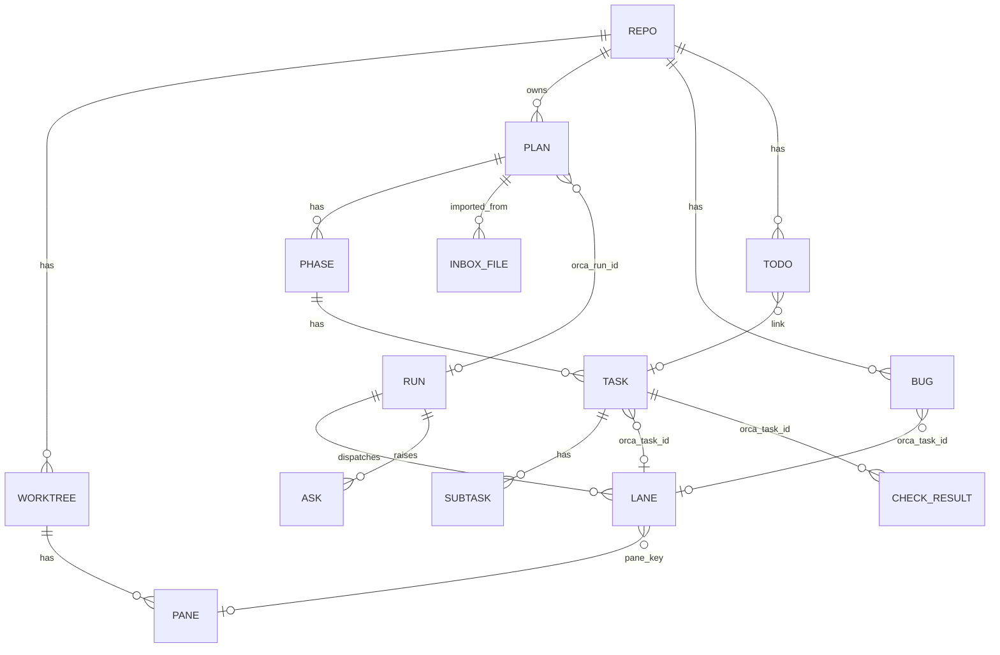

# mk-data.db schema v1

Date: 2026-10-24. Read-only research on this machine (Orca 1.4.239, macOS, `node:sqlite` = SQLite 3.53.4 under Node 24.22.0, both confirmed by `ELECTRON_RUN_AS_NODE=1 /Applications/Orca.app/Contents/MacOS/Orca -e ...` on an in-memory db). Nothing in Orca, upstream MatrixKoder, any database or the repo was changed except this file. Revises `screen-data-map.md` §5 to the decisions the user made after it (light-link tasks, no `task_link`, plan files as an inbox, Orca as source of truth).

Citation forms: `SDM §n` = `screen-data-map.md`; `BUS §n` = `orca-orchestration-bus.md`; `CLI §n` = `orca-cli-reference.md` (line numbers given where used); `Screen.dc.html CONST` = mock data in `/Users/rohits/Development/orca-matrixkoder/panel/screens/`; `PLAN` = `.matrixkoder/inbox/orca-dashboard-wiring.md`; `TPL` = `/Users/rohits/Development/matrixkoder/skills/matrixkoder/templates/plan.md`. `CMD:` = a read-only `--json` command I ran today. "unverified" = not confirmed on this machine.

Column tags used in every DDL comment:

1. `[O]` an Orca id stored as text. Never a foreign key to Orca, never edited by MK.
2. `[C]` cached Orca state. Written only by the sync loop (`UPSERT ... DO UPDATE SET <only the [C] columns>`), never edited by the dashboard or the CLI.
3. `[G]` cached `git`/`gh` state, written only by the sync loop (Orca has no CLI for it).
4. `[D]` derived by MK from cached state (status roll-ups). Written by the sync loop and by actions, recomputable.
5. `[M]` MK-owned. Written by actions, the `mk` CLI or import. The sync loop never writes it.
6. `[S]` sync bookkeeping (`first_seen_at`, `last_seen_at`, `gone_at`).

---

## 1. Entity diagram



Orca ids that appear as plain text columns (no FK): `repo.id` (uuid), `worktree.id` (`<repoId>::<path>`, CMD: `worktree ps` and `worktree list` return the same 8 ids), `pane.pane_key` (`<tabId>:<leafId>`, CMD: 3 of 3 agent panes joined a terminal by `tabId:leafId`; terminals also carry `recordedPaneKey`), `pane.terminal_handle` (`term_<uuid>`), `run.id` (`run_<12 hex>`), `plan_task.orca_task_id` / `bug.orca_task_id` (`task_...`), `lane.dispatch_id` (`ctx_...`), `ask.id` (gate id or message id `msg_...`).

Foreign keys exist only between MK-owned tables (plan to phase to task to subtask, plan_item, plan_version, inbox_file, lane_activity). Everything that points at an Orca object is a soft reference, so a missing Orca object never breaks an insert or a delete.

---

## 2. DDL

### 2.0 Open-time pragmas and conventions

```sql
PRAGMA journal_mode = WAL;
PRAGMA busy_timeout = 5000;
PRAGMA foreign_keys = ON;
-- Every write transaction starts with BEGIN IMMEDIATE (the worker sync loop and the mk CLI are two writers).
```

1. Timestamps are integer milliseconds since epoch, UTC. Orca orchestration timestamps are ISO strings (CMD: `run-list` `created_at` = `2026-10-24T20:47:46Z`, `inbox` `created_at`), while `worktree ps` / `terminal list` / `account list` use epoch ms. The sync loop converts ISO to ms before writing.
2. JSON columns are `TEXT` with `CHECK(json_valid(col))`.
3. Plan structure rows use integer surrogate keys so a re-import can match by `code` and keep ids stable. `code` is the id written in the plan file (`T6`, `SPIKE.1`).
4. Column-level ownership is the concurrency rule: the sync loop never writes `[M]` columns and the CLI/actions never write `[C]`/`[G]` columns, so two writers cannot overwrite each other's data.

### 2.1 Meta and sync bookkeeping

```sql
CREATE TABLE schema_version(
  version    INTEGER PRIMARY KEY,
  applied_at INTEGER NOT NULL,
  note       TEXT
);

CREATE TABLE counter(                       -- [M] id sequences: 'bug' -> B-n
  name  TEXT PRIMARY KEY,
  value INTEGER NOT NULL DEFAULT 0
);

CREATE TABLE kv(                            -- [S] cursors and small facts
  key        TEXT PRIMARY KEY,              -- 'inbox.sequence', 'orca.version', 'host.machine_name', 'git.cursor:<worktree_id>'
  value      TEXT NOT NULL,
  updated_at INTEGER NOT NULL
);

CREATE TABLE sync_state(                    -- [S] one row per source; feeds meta.stale and the stale banner
  source        TEXT PRIMARY KEY,           -- 'ps','terminals','repos','runs','tasks:<run>','workers:<run>','gates:<run>','inbox','quota','git','agent_cli','files'
  last_try_at   INTEGER,
  last_ok_at    INTEGER,
  last_error    TEXT,                       -- exact error text, no secrets
  last_error_at INTEGER,
  duration_ms   INTEGER,
  items         INTEGER
);
```

### 2.2 Orca cache: repos, worktrees, panes, runs, lanes, asks, quota

```sql
CREATE TABLE repo(
  id            TEXT PRIMARY KEY,           -- [O] orca repo list: repos[].id
  path          TEXT NOT NULL,              -- [C] repos[].path
  display_name  TEXT NOT NULL,              -- [C] repos[].displayName
  kind          TEXT,                       -- [C] repos[].kind
  badge_color   TEXT,                       -- [C] repos[].badgeColor
  remote_key    TEXT,                       -- [C] repos[].gitRemoteIdentity.canonicalKey (never remoteUrl: may carry credentials)
  added_at      INTEGER,                    -- [C] repos[].addedAt
  base_ref      TEXT,                       -- [G] git symbolic-ref refs/remotes/origin/HEAD, else 'main' guess
  base_ref_at   INTEGER,                    -- [G]
  bug_run_id    TEXT,                       -- [M] [O] Orca run used for bug-fix tasks of this repo (created on first `mk bug fix`)
  first_seen_at INTEGER NOT NULL,           -- [S]
  last_seen_at  INTEGER NOT NULL,           -- [S]
  gone_at       INTEGER                     -- [S] set when Orca no longer lists the repo
);
CREATE INDEX repo_path ON repo(path);

CREATE TABLE worktree(
  id                  TEXT PRIMARY KEY,     -- [O] worktree ps worktreeId == worktree list id
  repo_id             TEXT NOT NULL,        -- [O] repoId
  host_id             TEXT,                 -- [C] hostId
  path                TEXT NOT NULL,        -- [C] path
  branch              TEXT,                 -- [C] ps branch ("refs/heads/" stripped)
  head                TEXT,                 -- [C] worktree list head (short sha taken at read time)
  display_name        TEXT,                 -- [C] displayName
  is_main             INTEGER NOT NULL DEFAULT 0,  -- [C] isMainWorktree
  is_archived         INTEGER NOT NULL DEFAULT 0,  -- [C] isArchived
  parent_worktree_id  TEXT,                 -- [O] parentWorktreeId
  workspace_status    TEXT,                 -- [C] workspaceStatus (seen: in-progress)
  status              TEXT,                 -- [C] ps status (seen: active, working; docs also list inactive)
  live_terminal_count INTEGER NOT NULL DEFAULT 0,  -- [C] liveTerminalCount
  unverifiable_terminal_count INTEGER NOT NULL DEFAULT 0, -- [C]
  terminal_verdict    TEXT,                 -- [C] terminalVerdict (seen: live)
  last_activity_at    INTEGER,              -- [C] lastActivityAt
  last_output_at      INTEGER,              -- [C] lastOutputAt
  linked_pr           TEXT,                 -- [C] raw linkedPR as JSON text; shape unverified (null on all 8 worktrees today)
  git_base_ref        TEXT,                 -- [G] ref used for the numbers below
  git_ahead           INTEGER,              -- [G] git rev-list --count BASE..HEAD
  git_files           INTEGER,              -- [G] git diff --shortstat BASE...HEAD plus working tree
  git_added           INTEGER,              -- [G]
  git_removed         INTEGER,              -- [G]
  git_dirty           INTEGER,              -- [G]
  git_at              INTEGER,              -- [G] when the git numbers were taken
  git_error           TEXT,                 -- [G]
  first_seen_at       INTEGER NOT NULL,     -- [S]
  last_seen_at        INTEGER NOT NULL,     -- [S]
  gone_at             INTEGER               -- [S]
);
CREATE INDEX worktree_repo ON worktree(repo_id, gone_at);

CREATE TABLE pane(                           -- one row per terminal pane; agent columns are NULL for a plain shell
  pane_key          TEXT PRIMARY KEY,       -- [O] agents[].paneKey == terminal recordedPaneKey == tabId:leafId
  worktree_id       TEXT NOT NULL,          -- [O] terminal worktreeId / worktree ps parent
  repo_id           TEXT,                   -- [D] copied from worktree for cheap counts
  terminal_handle   TEXT,                   -- [O] terminals[].handle (NULL if the pane has agent state but no terminal row)
  tab_id            TEXT,                   -- [C] terminals[].tabId
  leaf_id           TEXT,                   -- [C] terminals[].leafId
  title             TEXT,                   -- [C] terminals[].title, cut to 120
  connected         INTEGER,                -- [C] terminals[].connected
  writable          INTEGER,                -- [C] terminals[].writable
  last_output_at    INTEGER,                -- [C] terminals[].lastOutputAt
  agent_type        TEXT,                   -- [C] agents[].agentType (claude, codex, omp, ...)
  agent_state       TEXT CHECK(agent_state IS NULL OR agent_state IN ('working','blocked','waiting','done')), -- [C] agents[].state
  agent_state_since INTEGER,                -- [C] agents[].stateStartedAt
  agent_updated_at  INTEGER,                -- [C] agents[].updatedAt
  parent_pane_key   TEXT,                   -- [C] agents[].parentPaneKey (sub-agent)
  tool_name         TEXT,                   -- [C] agents[].toolName (name only)
  task_title        TEXT,                   -- [C] agents[].taskTitle (null in all 3 live rows), cut to 120
  interrupted       INTEGER,                -- [C] agents[].interrupted
  turns             INTEGER NOT NULL DEFAULT 0, -- [M] +1 on each done->working transition seen by MK ("since MK started watching")
  first_seen_at     INTEGER NOT NULL,       -- [S]
  last_seen_at      INTEGER NOT NULL,       -- [S]
  gone_at           INTEGER                 -- [S]
);
-- NEVER stored from Orca: agents[].prompt, lastAssistantMessage, toolInput, preview, subagents[], subagentObservation, programStatus, terminals[].preview, ptyId, incarnationId.
CREATE INDEX pane_worktree ON pane(worktree_id, gone_at);
CREATE INDEX pane_handle ON pane(terminal_handle);

CREATE TABLE run(                            -- cache of Orca runs, so the sync loop knows what to pull and non-MK runs can be shown
  id                 TEXT PRIMARY KEY,      -- [O] run-list runs[].id
  objective          TEXT,                  -- [C] objective, cut to 200
  coordinator_handle TEXT,                  -- [C] coordinator_handle
  legacy             INTEGER NOT NULL DEFAULT 0, -- [C] legacy (the run_legacy_local placeholder is skipped)
  created_at         INTEGER,               -- [C] created_at (ISO -> ms)
  updated_at         INTEGER,               -- [C] updated_at
  repo_id            TEXT,                  -- [D] repo of the first lane seen for this run, or plan.repo_id / repo.bug_run_id owner
  first_seen_at      INTEGER NOT NULL,      -- [S]
  last_seen_at       INTEGER NOT NULL,      -- [S]
  gone_at            INTEGER                -- [S]
);

CREATE TABLE lane(                           -- Q1: a lane is a worker dispatch when a run exists, else a worktree with a live agent
  id                  INTEGER PRIMARY KEY,
  lane_key            TEXT NOT NULL UNIQUE, -- 'dsp:<dispatch_id>' or 'wt:<worktree_id>'
  kind                TEXT NOT NULL CHECK(kind IN ('dispatch','worktree')),
  repo_id             TEXT NOT NULL,        -- [O]
  label               TEXT NOT NULL,        -- [M] 'P1': phase lane_group (or phase code) for plan tasks, else 'L<n>' per repo
  run_id              TEXT,                 -- [O] kind=dispatch
  dispatch_id         TEXT,                 -- [O] worker-list workers[].dispatchId
  orca_task_id        TEXT,                 -- [O] workers[].taskId
  worktree_id         TEXT,                 -- [O] workers[].resource.worktreeId, or the worktree for kind=worktree
  pane_key            TEXT,                 -- [O] joined from terminal handle (workers[].agentTerminalHandle) to pane
  terminal_handle     TEXT,                 -- [O] workers[].agentTerminalHandle
  worker_state        TEXT,                 -- [C] workers[].workerState (starting,ready,start_unknown,failed,succeeded,stopping,stop_unknown,stopped,abandoned)
  dispatch_status     TEXT,                 -- [C] workers[].dispatchStatus (pending,dispatched,completed,failed,circuit_broken)
  stage_activity      TEXT,                 -- [C] workers[].projection.stage.activity (working,blocked,waiting,done,unknown)
  liveness            TEXT,                 -- [C] workers[].projection.liveness.verdict (live,unverifiable,exited)
  attention           TEXT,                 -- [C] projection.attention.categories joined by ','
  requires_action     INTEGER,              -- [C] projection.attention.requiresAction
  outcome             TEXT,                 -- [C] projection.outcome
  agent               TEXT,                 -- [C] worker-show worker.startOptions.launch.effective.agent (read once, immutable)
  model               TEXT,                 -- [C] ...effective.model
  effort              TEXT,                 -- [C] ...effective.effort
  phase               TEXT,                 -- [C] latest heartbeat payload.phase (implementing, verifying, ...)
  started_at          INTEGER,              -- [C] worker-show dispatch.dispatchedAt
  last_heartbeat_at   INTEGER,              -- [C] worker-show dispatch.lastHeartbeatAt
  ended_at            INTEGER,              -- [D] when the lane left working/waiting/blocked for good
  state               TEXT NOT NULL CHECK(state IN ('working','waiting','blocked','done','failed','stopped')), -- [D] rule in section 3.6
  state_at            INTEGER,              -- [D]
  first_seen_at       INTEGER NOT NULL,     -- [S]
  last_seen_at        INTEGER NOT NULL,     -- [S]
  CHECK((kind='dispatch' AND dispatch_id IS NOT NULL) OR (kind='worktree' AND worktree_id IS NOT NULL))
);
CREATE UNIQUE INDEX lane_dispatch ON lane(dispatch_id) WHERE dispatch_id IS NOT NULL;
CREATE UNIQUE INDEX lane_worktree_live ON lane(worktree_id) WHERE kind='worktree' AND ended_at IS NULL;
CREATE UNIQUE INDEX lane_label_live ON lane(repo_id, label) WHERE ended_at IS NULL;
CREATE INDEX lane_task ON lane(orca_task_id);
CREATE INDEX lane_state ON lane(repo_id, state, ended_at);

CREATE TABLE lane_activity(                  -- short per-lane feed for the Lanes "Activity" lines
  id       INTEGER PRIMARY KEY,
  lane_id  INTEGER NOT NULL REFERENCES lane(id) ON DELETE CASCADE,
  at       INTEGER NOT NULL,
  kind     TEXT NOT NULL CHECK(kind IN ('state','tool','check','commit','note')),
  text     TEXT NOT NULL                   -- <= 120 chars; tool NAME only, never toolInput, prompt or assistant text
);
CREATE INDEX lane_activity_lane ON lane_activity(lane_id, at DESC);

CREATE TABLE ask(                            -- Waiting: Orca gates and worker questions, cached, plus MK notes
  id             TEXT PRIMARY KEY,          -- [O] gate id (gate-list gates[].id) or question message id (inbox messages[].id)
  kind           TEXT NOT NULL CHECK(kind IN ('gate','question')),
  run_id         TEXT NOT NULL,             -- [O]
  orca_task_id   TEXT,                      -- [O] gate task_id / payload.taskId
  dispatch_id    TEXT,                      -- [O] payload.dispatchId (questions)
  thread_id      TEXT,                      -- [O] message thread_id (answer detection)
  title          TEXT NOT NULL,             -- [C] first line of gate.question / payload.question, cut to 160
  body           TEXT NOT NULL DEFAULT '',  -- [C] rest of that string, cut to 1500
  options        TEXT NOT NULL DEFAULT '[]' CHECK(json_valid(options)), -- [C] gate options / payload.options
  orca_status    TEXT NOT NULL CHECK(orca_status IN ('pending','resolved','timeout','answered','closed')), -- [C] gate: pending|resolved|timeout; question: pending|answered (thread rule)
  resolution     TEXT,                      -- [C] gate.resolution (cut to 300); question: text of the reply message if seen
  asked_at       INTEGER NOT NULL,          -- [C] created_at (ISO -> ms)
  resolved_at    INTEGER,                   -- [C] gate.resolved_at / reply message created_at
  recommendation TEXT,                      -- [M] "Jev: approve ..." line, set only through a plugin/CLI command; NULL hides the line
  rec_source     TEXT,                      -- [M]
  snoozed_until  INTEGER,                   -- [M] "Ask me later"
  first_seen_at  INTEGER NOT NULL,          -- [S]
  last_seen_at   INTEGER NOT NULL,          -- [S]
  gone_at        INTEGER                    -- [S]
);
CREATE INDEX ask_open ON ask(orca_status, asked_at DESC);
CREATE INDEX ask_task ON ask(orca_task_id);

CREATE TABLE quota(                          -- Settings > Agents and Routing "spare Claude below N%"
  provider       TEXT NOT NULL,             -- [C] key under account list result.rateLimits (claude, codex, gemini, opencodeGo, antigravity, ...)
  win            TEXT NOT NULL CHECK(win IN ('session','weekly','monthly')), -- [C] session = 5h window
  used_percent   REAL,                      -- [C] rateLimits.<p>.<win>.usedPercent
  window_minutes INTEGER,                   -- [C] .windowMinutes
  resets_at      INTEGER,                   -- [C] .resetsAt
  updated_at     INTEGER,                   -- [C] rateLimits.<p>.updatedAt
  error          TEXT,                      -- [C] rateLimits.<p>.error (session null + error text for codex today)
  status         TEXT,                      -- [C] rateLimits.<p>.status
  PRIMARY KEY(provider, win)
);

CREATE TABLE agent_cli(                      -- Settings > Agents "on PATH" probe (no Orca command exists)
  agent_id   TEXT PRIMARY KEY,              -- 'claude','codex','agy','opencode','omp','gemini',...
  found      INTEGER NOT NULL,              -- [G] command -v
  cli_path   TEXT,                          -- [G]
  version    TEXT,                          -- [G]
  error      TEXT,                          -- [G]
  checked_at INTEGER NOT NULL               -- [G]
);
```

### 2.3 Plans: plan, versions, phases, tasks, subtasks, items

```sql
CREATE TABLE plan(
  id              INTEGER PRIMARY KEY,
  slug            TEXT NOT NULL,             -- [M] block 1 `plan = "..."`
  repo_id         TEXT NOT NULL,             -- [O] repo the file was found in
  title           TEXT NOT NULL,             -- [M] block 2 heading `# <id> — <title>`
  status          TEXT NOT NULL CHECK(status IN ('imported','running','parked','done','archived')),
                                             -- imported = loaded, no run; running = Orca run exists; parked = MK stops starting tasks;
                                             -- done = all live tasks done and merged/accepted; archived = hidden
  version         INTEGER NOT NULL DEFAULT 1,-- [M] current plan_version.version
  file_status     TEXT,                      -- [M] block 1 `status` as written in the file (draft|approved|running|done|parked); informational
  integration_branch TEXT,                   -- [M] block 1 `integration`
  pushed          INTEGER NOT NULL DEFAULT 0,-- [M] block 1 `pushed`
  plan_branch     TEXT,                      -- [M] branch the plan's lanes merge into, if the orchestrator sets one
  pr_number       INTEGER,                   -- [G] from worktree.linked_pr or gh (unverified)
  pr_url          TEXT,                      -- [G]
  pr_state        TEXT CHECK(pr_state IS NULL OR pr_state IN ('open','ready','merged','closed')), -- [G] unverified (needs gh)
  orca_run_id     TEXT,                      -- [O] set at Start (run-create); one run per plan
  past_run_ids    TEXT NOT NULL DEFAULT '[]' CHECK(json_valid(past_run_ids)), -- [M] a restart moves orca_run_id here
  run_last_state  TEXT,                      -- [C] 'listed' | 'missing' from run-list
  started_at      INTEGER,                   -- [M]
  merged_at       INTEGER,                   -- [M] set by user action or by the orchestrator through the CLI
  done_at         INTEGER,                   -- [M]
  created_at      INTEGER NOT NULL,          -- [M]
  updated_at      INTEGER NOT NULL,          -- [M]
  UNIQUE(repo_id, slug)
);
CREATE INDEX plan_repo ON plan(repo_id, status);
CREATE UNIQUE INDEX plan_run ON plan(orca_run_id) WHERE orca_run_id IS NOT NULL;

CREATE TABLE plan_version(                   -- the file text as imported; the only home of blocks no screen shows (facts, shape, notes)
  plan_id     INTEGER NOT NULL REFERENCES plan(id) ON DELETE CASCADE,
  version     INTEGER NOT NULL,
  source_sha  TEXT NOT NULL,                 -- sha256 of the file bytes
  source_path TEXT NOT NULL,                 -- repo-relative path it had when imported
  body        TEXT NOT NULL,                 -- full file text (plans are ~30 KB)
  fit         TEXT NOT NULL CHECK(fit IN ('pass','partial')),
  missing     TEXT NOT NULL DEFAULT '[]' CHECK(json_valid(missing)),
  imported_at INTEGER NOT NULL,
  note        TEXT,                          -- 'initial' | 'merged: +2 tasks, ~3 changed, -1 dropped'
  PRIMARY KEY(plan_id, version)
);

CREATE TABLE plan_phase(                     -- block 5.n text + 5.n.0 settings. A "wave" is not a table: GROUP BY wave
  id           INTEGER PRIMARY KEY,
  plan_id      INTEGER NOT NULL REFERENCES plan(id) ON DELETE CASCADE,
  code         TEXT NOT NULL,                -- 'STORE' (settings `id`)
  ord          INTEGER NOT NULL,             -- block order (5.1, 5.2, ...)
  title        TEXT NOT NULL,
  goal         TEXT,                         -- text block "Goal:" line
  wave         INTEGER NOT NULL DEFAULT 1,   -- `wave` (same wave = parallel)
  lane_group   TEXT NOT NULL DEFAULT '',     -- `lane_group` ('' = own lane); lane label source
  deps         TEXT NOT NULL DEFAULT '[]' CHECK(json_valid(deps)),      -- phase codes (or <run>:<task>)
  owned        TEXT NOT NULL DEFAULT '[]' CHECK(json_valid(owned)),
  forbidden    TEXT NOT NULL DEFAULT '[]' CHECK(json_valid(forbidden)),
  commit_msg   TEXT,                         -- `commit`
  size         TEXT CHECK(size IS NULL OR size IN ('trivial','standard','complex')),
  route        TEXT NOT NULL DEFAULT '',     -- '' = Jev decides, else "<agent> <model> [<effort>]"
  reviewer     TEXT NOT NULL DEFAULT '',
  subagents    INTEGER NOT NULL DEFAULT 1,
  qa           TEXT NOT NULL DEFAULT '[]' CHECK(json_valid(qa)),
  serves       TEXT NOT NULL DEFAULT '[]' CHECK(json_valid(serves)),    -- goal ids from the text block
  hazards      TEXT NOT NULL DEFAULT '[]' CHECK(json_valid(hazards)),   -- risk ids
  carries      TEXT NOT NULL DEFAULT '[]' CHECK(json_valid(carries)),   -- C/T/A/R ids
  build_order  TEXT,
  dropped_at   INTEGER,                      -- set when a re-import no longer contains the phase
  UNIQUE(plan_id, code)
);
CREATE INDEX plan_phase_ord ON plan_phase(plan_id, wave, ord);

CREATE TABLE plan_task(                      -- plan structure (MK) + light link to ONE current Orca task (same pattern as bug)
  id             INTEGER PRIMARY KEY,
  plan_id        INTEGER NOT NULL REFERENCES plan(id) ON DELETE CASCADE,
  phase_id       INTEGER NOT NULL REFERENCES plan_phase(id),
  code           TEXT NOT NULL,              -- 'SPIKE.1' / 'T6'
  ord            INTEGER NOT NULL,
  origin         TEXT NOT NULL DEFAULT 'plan' CHECK(origin IN ('plan','todo')), -- 'todo' = created by "Make task"
  title          TEXT NOT NULL,
  description    TEXT,
  acceptance     TEXT NOT NULL DEFAULT '[]' CHECK(json_valid(acceptance)),
  covers         TEXT NOT NULL DEFAULT '[]' CHECK(json_valid(covers)),
  deps           TEXT NOT NULL DEFAULT '[]' CHECK(json_valid(deps)),      -- task/phase codes; MK evaluates them, they are NOT sent to Orca (see 3.3)
  risk           INTEGER NOT NULL DEFAULT 1 CHECK(risk BETWEEN 1 AND 5),
  size           TEXT CHECK(size IS NULL OR size IN ('trivial','standard','complex')),
  gate           TEXT,
  manual         TEXT,
  route          TEXT NOT NULL DEFAULT '',
  refs           TEXT NOT NULL DEFAULT '[]' CHECK(json_valid(refs)),
  owned          TEXT NOT NULL DEFAULT '[]' CHECK(json_valid(owned)),
  subagent       INTEGER NOT NULL DEFAULT 0,
  parallel       INTEGER NOT NULL DEFAULT 0,
  status         TEXT NOT NULL DEFAULT 'pending'
                 CHECK(status IN ('pending','ready','working','waiting','blocked','done','failed','cancelled')), -- [D] mapping in 3.3
  -- light link to Orca (same columns and meaning as bug)
  orca_run_id    TEXT,                       -- [O] the run the task was created in (== plan.orca_run_id at that time)
  orca_task_id   TEXT,                       -- [O] CURRENT Orca task; NULL until the task is started
  attempts       INTEGER NOT NULL DEFAULT 0, -- [M] number of Orca tasks ever created for this row
  past_task_ids  TEXT NOT NULL DEFAULT '[]' CHECK(json_valid(past_task_ids)), -- [M] earlier Orca task ids; a retry moves the current id here
  last_state     TEXT,                       -- [C] Orca task status: pending|ready|dispatched|completed|failed|blocked|missing
  last_state_at  INTEGER,                    -- [C] when last_state last changed (sync time)
  started_at     INTEGER,                    -- [M] first task-create
  done_at        INTEGER,                    -- [D] when status became done
  spec_drift     INTEGER NOT NULL DEFAULT 0, -- [M] 1 = the plan text changed after the Orca task was created
  dropped_at     INTEGER,                    -- re-import no longer contains the task
  created_at     INTEGER NOT NULL,
  updated_at     INTEGER NOT NULL,
  UNIQUE(plan_id, code)
);
CREATE INDEX plan_task_phase ON plan_task(phase_id, ord);
CREATE INDEX plan_task_orca ON plan_task(orca_task_id) WHERE orca_task_id IS NOT NULL;
CREATE INDEX plan_task_status ON plan_task(plan_id, status) WHERE dropped_at IS NULL;

CREATE TABLE plan_subtask(                   -- MK-only: Orca has no subtask status (BUS §1, SDM §3 item 6)
  id           INTEGER PRIMARY KEY,
  plan_id      INTEGER NOT NULL REFERENCES plan(id) ON DELETE CASCADE,
  task_id      INTEGER NOT NULL REFERENCES plan_task(id) ON DELETE CASCADE,
  code         TEXT NOT NULL,                -- 'T6.3' / 'WIRE.2.1'
  ord          INTEGER NOT NULL,
  title        TEXT NOT NULL,
  description  TEXT,
  acceptance   TEXT NOT NULL DEFAULT '[]' CHECK(json_valid(acceptance)),
  deps         TEXT NOT NULL DEFAULT '[]' CHECK(json_valid(deps)),
  owned        TEXT NOT NULL DEFAULT '[]' CHECK(json_valid(owned)),
  status       TEXT NOT NULL DEFAULT 'pending' CHECK(status IN ('pending','working','waiting','blocked','done')),
  note         TEXT NOT NULL DEFAULT '',     -- "now", "decide", "← T6.4" (decide/dep notes are derived at read; this holds manual notes)
  updated_at   INTEGER,
  dropped_at   INTEGER,
  UNIQUE(plan_id, code)
);
CREATE INDEX plan_subtask_task ON plan_subtask(task_id, ord);

CREATE TABLE plan_item(                      -- goals, contracts, tests, assumptions, rollout, settings, gates, risks, questions, log lines, meta
  id        INTEGER PRIMARY KEY,
  plan_id   INTEGER NOT NULL REFERENCES plan(id) ON DELETE CASCADE,
  kind      TEXT NOT NULL CHECK(kind IN ('goal','contract','test','assumption','rollout','setting','gate','risk','question','log','meta')),
  code      TEXT,                            -- 'G1','C2','T3','A1','R1','S2','K4','Q5', gate name; NULL for log lines
  ord       INTEGER NOT NULL,
  text      TEXT NOT NULL,
  data      TEXT NOT NULL DEFAULT '{}' CHECK(json_valid(data)),
              -- gate:     {"proves":["G1"],"command":"npm test","timeout":600,"extra":true}
              -- risk:     {"level":4,"guard":"...","ref":"SERVE.1"}
              -- question: {"blocks":"WIRE.2","pick":"..."}
              -- test:     {"level":"unit","file":"test/x.mjs","written_by":"STORE.1"}
              -- log:      {"date":"2026-10-24","kind":"decision","who":"user"}
  done      INTEGER NOT NULL DEFAULT 0,      -- question ticked `[x]` (set by re-import only in v1)
  UNIQUE(plan_id, kind, code, ord)
);
CREATE INDEX plan_item_kind ON plan_item(plan_id, kind, ord);
```

### 2.4 Inbox plan files

```sql
CREATE TABLE inbox_file(                     -- one row per plan .md seen in <repo>/.matrixkoder/inbox/ (top level) or inbox/archive/
  id            INTEGER PRIMARY KEY,
  repo_id       TEXT NOT NULL,               -- [O]
  path          TEXT NOT NULL,               -- repo-relative CURRENT location: 'inbox/x.md' | 'inbox/archive/x.md' | 'inbox/.deleted/x-<time>/x.md'
  name          TEXT NOT NULL,               -- file name
  slug          TEXT,                        -- block 1 `plan`; NULL when unparsable
  title         TEXT,                        -- block 2 heading, else first `# ` heading
  sha           TEXT NOT NULL,               -- sha256 of file bytes
  size          INTEGER NOT NULL,
  mtime         INTEGER NOT NULL,
  fit           TEXT NOT NULL CHECK(fit IN ('pass','partial','not_a_plan')),
  missing       TEXT NOT NULL DEFAULT '[]' CHECK(json_valid(missing)),  -- ["Block 6 Gates","phase STORE: owned"]
  status        TEXT NOT NULL DEFAULT 'new'
                CHECK(status IN ('new','changed','imported','archived','deleted','missing')),
  plan_id       INTEGER REFERENCES plan(id) ON DELETE SET NULL,         -- plan this file produced or would update
  plan_version  INTEGER,                     -- version created by this file (status imported)
  first_seen_at INTEGER NOT NULL,
  status_at     INTEGER NOT NULL,
  imported_at   INTEGER,
  UNIQUE(repo_id, path)
);
CREATE INDEX inbox_file_repo ON inbox_file(repo_id, status);
CREATE INDEX inbox_file_sha ON inbox_file(repo_id, sha);
```

### 2.5 User lists: bugs and todos

```sql
CREATE TABLE bug(                            -- decision 3, columns exactly as decided, plus one marked addition
  id            TEXT PRIMARY KEY,            -- [M] 'B-n' from counter('bug'); unique across repos
  repo_id       TEXT NOT NULL,               -- [O]
  title         TEXT NOT NULL,               -- [M]
  details       TEXT NOT NULL DEFAULT '',    -- [M] full write-up (no .md files)
  file          TEXT,                        -- [M]
  line          INTEGER,                     -- [M]
  risk          INTEGER NOT NULL DEFAULT 3 CHECK(risk BETWEEN 1 AND 5),  -- [M]
  status        TEXT NOT NULL DEFAULT 'open' CHECK(status IN ('open','fixing','waiting','fixed','wontfix')), -- [D] fixing/waiting/fixed follow the Orca task; open/wontfix are user-set
  reported_by   TEXT NOT NULL DEFAULT 'user',-- [M] 'user' | agent name | lane label
  orca_run_id   TEXT,                        -- [O] repo.bug_run_id at the time of the fix
  orca_task_id  TEXT,                        -- [O] CURRENT Orca task
  attempts      INTEGER NOT NULL DEFAULT 0,  -- [M] Orca tasks ever created for this bug
  past_task_ids TEXT NOT NULL DEFAULT '[]' CHECK(json_valid(past_task_ids)), -- [M] retry moves the current id here
  last_state    TEXT,                        -- [C] Orca task status: pending|ready|dispatched|completed|failed|blocked|missing
  last_state_at INTEGER,                     -- [C] ADDITION to the decided list (same field the task row has); drop it if the list must stay exact
  created_at    INTEGER NOT NULL,
  updated_at    INTEGER NOT NULL,
  fixed_at      INTEGER
);
CREATE INDEX bug_repo ON bug(repo_id, status);
CREATE INDEX bug_orca ON bug(orca_task_id) WHERE orca_task_id IS NOT NULL;

CREATE TABLE todo(
  id         INTEGER PRIMARY KEY,
  repo_id    TEXT NOT NULL,                  -- [O]
  text       TEXT NOT NULL,
  grp        TEXT NOT NULL DEFAULT 'today' CHECK(grp IN ('today','soon','later')),
  done       INTEGER NOT NULL DEFAULT 0,
  sort       INTEGER NOT NULL DEFAULT 0,
  link_kind  TEXT CHECK(link_kind IS NULL OR link_kind IN ('task','phase','bug')),
  link_ref   TEXT,                           -- task: plan_task.id | phase: plan_phase.id | bug: bug.id (as text); a dropped target shows as plain text
  created_at INTEGER NOT NULL,
  done_at    INTEGER,
  CHECK((link_kind IS NULL) = (link_ref IS NULL))
);
CREATE INDEX todo_repo ON todo(repo_id, done, grp, sort);
```

### 2.6 Observations, history, decisions

```sql
CREATE TABLE check_result(                   -- build/test/review results; Orca has none. Q3: agents report with `orca orchestration send --type status`
  id            INTEGER PRIMARY KEY,
  orca_task_id  TEXT,                        -- [O] payload.taskId (maps to plan_task or bug through v_orca_task_owner)
  dispatch_id   TEXT,                        -- [O] payload.dispatchId
  name          TEXT NOT NULL,               -- build | test | review | other (payload.check)
  status        TEXT NOT NULL CHECK(status IN ('pending','running','passed','failed','asks','skipped')),
  passed        INTEGER,
  total         INTEGER,
  detail        TEXT,                        -- <= 200 chars
  source        TEXT NOT NULL UNIQUE,        -- 'msg:<message id>' (idempotent re-poll)
  at            INTEGER NOT NULL
);
CREATE INDEX check_task ON check_result(orca_task_id, name, at DESC);

CREATE TABLE event_log(                      -- Events screen; Orca keeps no plugin-event history and inbox has no cursor
  id        INTEGER PRIMARY KEY,
  at        INTEGER NOT NULL,
  kind      TEXT NOT NULL CHECK(kind IN ('lane','gate','ask','commit','bus')),
  repo_id   TEXT,
  text      TEXT NOT NULL,
  src       TEXT,                            -- "P1 claude · T6"
  ref       TEXT,                            -- 'msg:<id>' | 'pane:<key>:<since>' | 'sha:<x>' | 'ask:<id>'
  payload   TEXT CHECK(payload IS NULL OR json_valid(payload))  -- redacted, <= 2 KB; heartbeats are never stored
);
CREATE UNIQUE INDEX event_ref ON event_log(kind, ref) WHERE ref IS NOT NULL;
CREATE INDEX event_at ON event_log(at DESC);
CREATE INDEX event_repo ON event_log(repo_id, at DESC);

CREATE TABLE decision_log(                   -- Waiting actions: the 10 s undo window (Q2), recovery after a worker restart, "resolved" history
  id          INTEGER PRIMARY KEY,
  repo_id     TEXT,
  run_id      TEXT,
  ask_id      TEXT,                          -- ask.id
  kind        TEXT NOT NULL CHECK(kind IN ('gate','question')),
  title       TEXT NOT NULL,
  action      TEXT NOT NULL CHECK(action IN ('approve','rework','answer')),
  answer      TEXT,                          -- option label or rework text (cut to 500)
  actor       TEXT NOT NULL DEFAULT 'user',
  status      TEXT NOT NULL CHECK(status IN ('pending','sent','undone','failed','expired')),
  command     TEXT NOT NULL CHECK(json_valid(command)),  -- argv JSON array of the single orca call to run at commit_at
  request_id  TEXT NOT NULL,                 -- passed as --retry-request so a replay is idempotent
  commit_at   INTEGER,
  sent_at     INTEGER,
  error       TEXT,
  created_at  INTEGER NOT NULL
);
CREATE INDEX decision_pending ON decision_log(status, commit_at);
CREATE INDEX decision_ask ON decision_log(ask_id);

CREATE TABLE alert_sent(                     -- notification de-duplication
  key TEXT PRIMARY KEY,                      -- 'ask:<id>','laneDone:<dispatch>','quiet:<lane_key>:<heartbeat>'
  at  INTEGER NOT NULL
);
```

### 2.7 Views

```sql
-- Which MK row owns an Orca task id (current or past). Replaces the draft task_link table.
CREATE VIEW v_orca_task_owner AS
  SELECT orca_task_id AS orca_task_id, 'plan_task' AS owner_kind, CAST(id AS TEXT) AS owner_id, 1 AS is_current
    FROM plan_task WHERE orca_task_id IS NOT NULL
  UNION ALL
  SELECT j.value, 'plan_task', CAST(t.id AS TEXT), 0 FROM plan_task t, json_each(t.past_task_ids) j
  UNION ALL
  SELECT orca_task_id, 'bug', id, 1 FROM bug WHERE orca_task_id IS NOT NULL
  UNION ALL
  SELECT j.value, 'bug', b.id, 0 FROM bug b, json_each(b.past_task_ids) j;

-- Phase roll-up: done / working / waiting / failed / ready / pending
CREATE VIEW v_phase AS
  SELECT p.id AS phase_id, p.plan_id, p.code, p.title, p.wave, p.ord,
         COUNT(t.id) AS total,
         SUM(t.status='done') AS done,
         CASE
           WHEN COUNT(t.id)=0 THEN 'pending'
           WHEN SUM(t.status='done')=COUNT(t.id) THEN 'done'
           WHEN SUM(t.status='working')>0 THEN 'working'
           WHEN SUM(t.status='waiting')>0 THEN 'waiting'
           WHEN SUM(t.status IN ('failed','cancelled'))>0 THEN 'failed'
           WHEN SUM(t.status='ready')>0 THEN 'ready'
           ELSE 'pending' END AS status
    FROM plan_phase p LEFT JOIN plan_task t ON t.phase_id=p.id AND t.dropped_at IS NULL
   WHERE p.dropped_at IS NULL
   GROUP BY p.id;

-- Per-plan counts for Projects cards, Overview and Plan summary
CREATE VIEW v_plan_counts AS
  SELECT pl.id AS plan_id, pl.repo_id, pl.status,
         (SELECT COUNT(*) FROM plan_phase WHERE plan_id=pl.id AND dropped_at IS NULL) AS phases,
         (SELECT COUNT(DISTINCT wave) FROM plan_phase WHERE plan_id=pl.id AND dropped_at IS NULL) AS waves,
         (SELECT COUNT(*) FROM plan_task WHERE plan_id=pl.id AND dropped_at IS NULL) AS tasks,
         (SELECT COUNT(*) FROM plan_task WHERE plan_id=pl.id AND dropped_at IS NULL AND status='done') AS tasks_done,
         (SELECT COUNT(*) FROM plan_subtask WHERE plan_id=pl.id AND dropped_at IS NULL) AS subtasks,
         (SELECT COUNT(*) FROM plan_subtask WHERE plan_id=pl.id AND dropped_at IS NULL AND status='done') AS subtasks_done
    FROM plan pl;
```

### 2.8 Ownership summary

| Table | Orca ids `[O]` | Cached Orca `[C]`/`[G]` | MK-owned `[M]` / derived `[D]` |
|---|---|---|---|
| repo | id | path, display_name, kind, badge_color, remote_key, added_at, base_ref | bug_run_id |
| worktree | id, repo_id, parent_worktree_id | everything else except sync bookkeeping | none |
| pane | pane_key, worktree_id, terminal_handle | tab/leaf, title, connected, writable, agent_*, tool_name, task_title | turns |
| run | id | objective, coordinator_handle, legacy, timestamps | repo_id [D] |
| lane | run_id, dispatch_id, orca_task_id, worktree_id, pane_key, terminal_handle | worker_state ... started_at, last_heartbeat_at | label, state [D], ended_at [D] |
| ask | id, run_id, orca_task_id, dispatch_id, thread_id | title, body, options, orca_status, resolution, times | recommendation, rec_source, snoozed_until |
| plan | repo_id, orca_run_id | run_last_state, pr_* [G] | all other columns |
| plan_task | orca_run_id, orca_task_id | last_state, last_state_at | structure, status [D], attempts, past_task_ids, spec_drift |
| plan_phase / plan_subtask / plan_item / plan_version | none | none | all |
| inbox_file | repo_id | none (disk facts) | all |
| bug | repo_id, orca_run_id, orca_task_id | last_state, last_state_at | all other columns, status [D] |
| todo | repo_id | none | all |
| check_result | orca_task_id, dispatch_id | all (read from `status` messages) | none |
| event_log, quota, agent_cli | refs only | all | none |
| decision_log | run_id, ask_id | none | all |

### 2.9 What changed against the draft in `screen-data-map.md` §5

1. `task_link` is dropped. Reason it is not needed: a plan task has one current Orca task and a short JSON list of earlier ones (same as bug). The only lookup that needs the reverse direction (Orca task id to MK row, for asks, checks and lanes) is served by `v_orca_task_owner` plus the in-memory map the sync loop builds from `plan_task`/`bug` once per tick (hundreds of rows). The one reason that would justify a link table is querying thousands of retries by Orca id from SQL on every API read; the dashboard API never does that. `task_link.kind` (build/fix/restart/review) is replaced by `attempts` and `past_task_ids`; the kind of a retry is not shown on any screen.
2. `plan_task` now carries the light-link columns (`orca_run_id`, `orca_task_id`, `attempts`, `past_task_ids`, `last_state`, `last_state_at`) and a derived `status`.
3. `plan.status` becomes `imported|running|parked|done|archived`. The draft's `verifying` and `merged` are not statuses: the Plan/Build/Verify/Merge stage is derived (section 3.1) and merge is `plan.merged_at`.
4. New: `plan_version`, `plan_item`, `inbox_file` with a real lifecycle, `repo`, `worktree`, `pane`, `run`, `ask`, `quota`, `agent_cli`, `sync_state`, `counter`, `kv`.
5. `lane` is now keyed by `lane_key` (dispatch or worktree) and holds the cached dispatch fields; `turns` moved to `pane`; `waiting_note` was merged into `ask` (it was keyed by the ask id anyway).
6. `decision_log` stores the exact `command` argv and a `request_id`, so a pending undo window survives the worker being reaped after 5 idle minutes (PLAN risk K1).
7. `cursor` became `kv`; `lane_activity` kept but its text is limited to tool names (section 5, Lanes).
8. `planned_agent/model/effort/branch` columns of the draft `plan_task` are replaced by `route` (the template's own field, `"<agent> <model> [<effort>]"`, TPL legend). The branch-name hint on the Overview idle card has no source (section 5, Overview).

---

## 3. Status lifecycles

### 3.1 Plan (`plan.status`)

| From | To | Cause |
|---|---|---|
| (file) | imported | user action Import (or `mk plan import`), file valid as pass or partial |
| imported | running | user action Start: `orca orchestration run-create --objective "<title>"`, then `plan.orca_run_id` set |
| running | parked | user action Park (MK-only flag; MK stops starting tasks, does not stop Orca workers) |
| parked | running | user action Resume |
| running | done | all live tasks `done` and `merged_at` set (user action "Mark merged", or a pr_state=merged sync); plan gates are checked by the orchestrator, not by MK |
| any | archived | user action Archive plan (hides it; rows kept) |
| archived/done | imported | not allowed; import a new slug (re-import of a done plan is refused, section 6.5) |

The Overview stage pill is derived, not stored: Plan = `imported` or no task started; Build = any task started and not all done; Verify = all tasks done and a test/build `check_result` is not yet all passed; Merge = all checks passed and `merged_at` is NULL; finished = `merged_at` set. The Build bar value is `tasks_done / tasks` from `v_plan_counts`.

### 3.2 Inbox file (`inbox_file.status`)

| From | To | Cause |
|---|---|---|
| (none) | new | file watcher or rescan finds a top-level `inbox/*.md` whose slug has no plan in this repo |
| (none) | changed | same, but a plan with this `slug` already exists in this repo (re-import candidate, button reads "Update plan (v2)") |
| new, changed | new, changed | file content changed on disk: `sha`, `mtime`, `fit`, `missing` refreshed |
| new, changed | imported | user action Import: file moved to `inbox/archive/`, plan loaded (path updated) |
| new, changed | archived | user action Archive: file moved to `inbox/archive/`, nothing loaded |
| archived, imported | new or changed | user action Restore: file moved back to top level (refused if the name exists); status recomputed by rule 1 or 2 |
| any | deleted | user action Delete: copied to `inbox/.deleted/<name>-<time>/`, verified, removed |
| any | missing | the file is gone from disk and no MK move explains it; reappearing returns it to its previous kind |

`fit` (pass, partial, not_a_plan) is orthogonal to `status` and is recomputed whenever `sha` changes. `not_a_plan` files can be listed, archived, deleted, but not imported.

### 3.3 Plan task (`plan_task.status`)

Cached Orca state to MK status. The sync loop recomputes this on every tick from `last_state`, pending asks and MK dependency evaluation:

| Condition (first match wins) | MK status |
|---|---|
| `dropped_at` set | excluded from all counts |
| no `orca_task_id` and any phase dep not done, or the phase's wave not reached | pending |
| no `orca_task_id` and an own task dep (`deps`) not done | blocked (screen shows "after T6") |
| no `orca_task_id`, all deps done, no unticked open question blocks it | ready |
| `last_state` = `completed` | done |
| `last_state` = `failed` and Orca `result` = `cancelled` | cancelled |
| `last_state` = `failed` | failed (screen shows "attempt N", N = `attempts`) |
| `last_state` in `dispatched`/`blocked`/`ready` with a pending `ask` for this Orca task (gate task_id, or question payload.taskId) | waiting |
| `last_state` = `blocked` (no pending ask) | blocked |
| `last_state` = `dispatched` | working |
| `last_state` = `ready` or `pending` (Orca task created, not dispatched) | ready |
| `last_state` = `missing` | keep previous status, plan shows "Orca task missing: Retry" |

Transitions that are actions:

1. Start now / Run next phase / Add lane for a task: `task-create` (unless an Orca task exists), then `worker-start --task`. Writes `orca_run_id`, `orca_task_id`, `attempts+1`, `started_at`. MK does not pass `--deps`: dependency tasks may not exist in Orca yet, and a failed Orca dependency never promotes its dependents (BUS §1 DAG item 4, inferred), so MK evaluates `deps` itself and starts a task only when they are `done`.
2. Retry (task is `failed`, `cancelled` or `missing`): new `task-create`; the old id moves into `past_task_ids`, `attempts+1`, `last_state` reset. The live run already retries this way ("PARSE fix r2/r3", SDM §1.1).
3. Cancel: stop or release the worker, then `task-update --id T --status failed --result cancelled` (CLI §2004 notes this recipe) so Orca reads `failed/cancelled`.
4. Subtasks: when the task becomes `done`, every non-`skipped` subtask not yet done is set `done` (`updated_at` now). When the task becomes `failed`/`cancelled`, subtasks keep their state.

### 3.4 Subtask (`plan_subtask.status`)

`pending` (default) -> `working` -> `done`; `waiting` while a pending ask exists for the parent task and the subtask is the one marked `working` (note "decide"); `blocked` when an own dep is not done (note "← T6.4"). Writers: (1) auto-complete when the parent task completes (3.3 item 4); (2) the orchestrator through a `mk subtask set <code> <status> [--note]` CLI (new, see section 8); (3) import for new codes (pending). The dashboard has no subtask button (Plan screen, SDM §2.4).

### 3.5 Bug (`bug.status`)

| From | To | Cause |
|---|---|---|
| (none) | open | `mk bug add` or the dashboard "Add" |
| open | fixing | Fix / `mk bug fix`: `task-create` ok, `orca_task_id` stored, `attempts+1` |
| fixing | waiting | Orca task has a pending ask (gate or question) |
| waiting | fixing | the ask is answered |
| fixing/waiting | fixed | Orca task `completed`; `fixed_at` set |
| fixing | open | Orca task `failed` (keeps `attempts`, `last_state=failed`; row shows "attempt N failed"); `mk bug fix` again moves the id into `past_task_ids` |
| open/fixing | wontfix | user action Close |
| fixed/wontfix | open | user action Reopen (`fixed_at` cleared) |

Orca `ready` or `dispatched` both show as `fixing` (`last_state` tells queued from running). A task shown as `missing` keeps the status and the row shows "Orca task missing".

### 3.6 Pane and lane

Pane (cached, one per terminal pane):

| State | Meaning | Cause |
|---|---|---|
| (new row) | first seen in `terminal list` or `worktree ps agents[]` | sync tick or `agent.status.changed` |
| agent_state working / blocked / waiting / done | Orca agent state, copied | `agents[].state`; event payload `state` applies instantly |
| `done` -> `working` | a new turn | `pane.turns += 1` |
| gone (`gone_at` set) | absent from both lists on 2 consecutive complete pulls, or `worktree.removed` | row kept 7 days then pruned |

Lane (one row per dispatch, or per worktree with a live agent and no dispatch pointing at it). `lane.state` is derived in this order:

| Condition | state |
|---|---|
| `worker_state` = `failed` or `dispatch_status` in (`failed`,`circuit_broken`) | failed |
| `worker_state` in (`stopped`,`stopping`,`abandoned`,`stop_unknown`) | stopped |
| `worker_state` = `succeeded` or `dispatch_status` = `completed` | done |
| pending `ask` for this dispatch/task, or `requires_action` with category input/approval/guidance | waiting |
| `stage_activity` = `blocked`, or pane `agent_state` = `blocked` | blocked |
| otherwise (`stage_activity` working/unknown with `liveness` live, or pane `working`) | working |
| kind=worktree: pane `done` | done |
| kind=worktree: pane gone | stopped |

`ended_at` is set the first time a lane reaches done, failed or stopped. "Idle" lanes on Overview and Lanes ("P3 · starts when wave 2 merges") are synthetic rows built at read time from phases whose tasks are all `pending`/`ready`/`blocked` and have no lane; they are not stored.

---

## 4. Sync rules

One sync loop in the worker: every 10 s, plus an immediate (debounced 500 ms) pull on `agent.status.changed`, `worktree.created`, `worktree.removed`. All reads are `orca ... --json` with a 10 s timeout, run in parallel (a full pull for one run measured about 0.75 s, SDM §4). `sync_state` is updated per source. If a call fails, the cached rows stay as they are and nothing is treated as "gone"; the error text goes to `sync_state.last_error` and the snapshot shows `runtimeOk:false` or a per-source stale age.

Gone-detection rule used below ("2 complete pulls"): an object is marked gone only after it is missing from two consecutive successful pulls whose result is complete (`truncated:false`, `hostScope.omittedHostIds` empty, no paging `hasMore`). A reappearing object clears `gone_at`.

| Cached columns | Command | JSON path | Cadence | When the Orca object disappears |
|---|---|---|---|---|
| repo.* | `orca repo list --json` | `result.repos[]` (`id,path,displayName,kind,badgeColor,addedAt,gitRemoteIdentity.canonicalKey`) | 60 s, and on worktree.created/removed | `gone_at` set; plans, bugs, todos of that repo stay; the Projects card shows "removed from Orca" |
| repo.base_ref, worktree.git_* | `git` in the worktree path (`symbolic-ref`, `rev-list --count`, `diff --shortstat`) | n/a | 10 s, only worktrees with a non-ended lane or in the selected repo; base_ref 10 min | git error text goes to `git_error`; old numbers kept with their `git_at` |
| worktree.* (except head) | `orca worktree ps --json` | `result.worktrees[]` (`worktreeId,repoId,hostId,path,branch,displayName,isMainWorktree,isArchived,parentWorktreeId,workspaceStatus,status,liveTerminalCount,unverifiableTerminalCount,terminalVerdict,lastActivityAt,lastOutputAt,linkedPR`) | 10 s + events | `gone_at` after 2 complete pulls or at once on `worktree.removed`; its panes get `gone_at`; its worktree-kind lanes go to `stopped` |
| worktree.head | `orca worktree list --json` | `result.worktrees[].head` | 10 s (same tick) | as above |
| pane agent_* | `orca worktree ps --json` | `worktrees[].agents[]` (`paneKey,state,agentType,stateStartedAt,updatedAt,parentPaneKey,toolName,taskTitle,interrupted`) | 10 s; `agent.status.changed` payload `{paneKey,state}` applied immediately | an agent missing from `agents[]` while its terminal is listed: agent_* set NULL (the terminal stays) |
| pane terminal columns | `orca terminal list --json` | `result.terminals[]` (`handle,tabId,leafId,recordedPaneKey,worktreeId,title,connected,writable,lastOutputAt`) | 10 s | `gone_at` after 2 complete pulls (`truncated:false`) |
| run.* | `orca orchestration run-list --json` | `result.runs[]` (`id,objective,coordinator_handle,legacy,created_at,updated_at`), `nextCursor` | 10 s | `gone_at`; a plan with that `orca_run_id` gets `run_last_state='missing'` and a banner; tasks keep their last state |
| plan_task.last_state / bug.last_state | `orca orchestration task-list --run R --brief --json` | `result.tasks[]` (`id,status,result`) | 10 s per run that is the `orca_run_id` of a running plan or `repo.bug_run_id` | task id not listed while the run is listed: `last_state='missing'`, status unchanged, user may Retry. Never marked done or failed by absence. Task-list paging/limit is unverified (`count` only, no cursor in CMD) |
| lane.* worker cols | `orca orchestration worker-list --run R --json` | `result.workers[]` (`dispatchId,taskId,workerState,dispatchStatus,agentTerminalHandle,resource.worktreeId,projection.stage.activity,projection.liveness.verdict,projection.attention.*,projection.outcome`), `page.hasMore` | 10 s per tracked run | worker absent while run listed: lane `state` computed from the last cached values, then `stopped` after 2 complete pulls |
| lane.agent/model/effort/started_at | `orca orchestration worker-show --dispatch D --json` | `worker.startOptions.launch.effective.{agent,model,effort}`, `dispatch.dispatchedAt` | once per dispatch (immutable), retried until non-null | none needed |
| lane.last_heartbeat_at, lane.phase | `orca orchestration inbox --limit 100 --json` | `messages[]` with `type=heartbeat`: `payload.phase`, `payload.dispatchId`, `created_at` | 10 s | n/a (latest value wins) |
| ask (gates) | `orca orchestration gate-list --run R --json` | `result.gates[]` (`id,task_id,question,options,status,resolution,created_at,resolved_at`) | 10 s per tracked run | `gone_at`; a pending gate that vanished is shown as resolved elsewhere |
| ask (questions) | `orca orchestration inbox --limit 100 --json` | `messages[]` where `type=question`; answered when a later message has the same `thread_id` (verified on 2 live threads, SDM §2.5) | 10 s | n/a; a question older than the `--limit` window that was still pending is kept pending until its thread shows an answer, or marked `closed` after 24 h |
| check_result | same `inbox` call | `messages[]` with `type=status` and `payload.check`: `{check,passed,total,status}` (payload shape is the agreement in PLAN Q3; unverified live) | 10 s | n/a |
| event_log (bus) | same `inbox` call | all non-heartbeat messages; cursor `kv('inbox.sequence')` = highest `sequence` stored | 10 s | Orca message gone: nothing happens (history is ours). If the newest returned `sequence` is more than 100 above the cursor a gap is logged as one event row "history gap" |
| event_log (lane) | events + ps diff | `agent.status.changed` / state change | immediate | n/a |
| event_log (commit) | `git log --since <cursor>` in each tracked worktree | sha, subject | 10 s | n/a |
| quota.* | `orca account list --json` | `result.rateLimits.<provider>.{session,weekly,monthly}.{usedPercent,windowMinutes,resetsAt}`, `.updatedAt`, `.error`, `.status` | 60 s | provider key missing: rows deleted for that provider |
| agent_cli.* | `command -v CLI`, `CLI --version` in the worker | n/a | on Detect and every 10 min | n/a |
| kv host.machine_name | `orca host list --json` | `result.hosts[0].machineName` | 60 s | keeps the last value |
| inbox_file.* | file scan of `<repo.path>/.matrixkoder/inbox/*.md`, `inbox/archive/`, plus a watcher | disk | on change and every 30 s | status `missing` (section 3.2) |

Writes made by actions are "Orca first, then the row": call the `orca` action with `--retry-request mk-<kind>-<row>-<attempt>` (the flag exists on `task-create`, `reply`, `gate-resolve`, `run-create`, `worker-start`, CLI lines 1766, 1931, 1967, 2276, 2068), then write the row in one transaction. If the process dies between the two, a replay with the same request id returns the same receipt and the row update is redone. As a second net (proposed, unverified that Orca keeps the text) the first line of every task spec the plugin creates is `mk-ref: plan:<slug>:<code>#<attempt>` or `mk-ref: bug:<id>#<attempt>`; the sync loop adopts an Orca task carrying such a tag that no row points to.

---

## 5. Screen to table map

Notation: `table.col` feeds a field; **W:** lists what a button writes. "Orca call" means the action calls Orca first, then updates the row (section 4). Every screen shares the tab bar badges:

| Badge | Query |
|---|---|
| Lanes | `COUNT(*) FROM lane WHERE repo_id=? AND ended_at IS NULL AND state IN ('working','waiting','blocked')` |
| Waiting | `COUNT(*) FROM ask WHERE orca_status='pending' AND gone_at IS NULL AND (snoozed_until IS NULL OR snoozed_until<now)` joined to the repo through `run.repo_id` |
| Inbox | `COUNT(*) FROM inbox_file WHERE repo_id=? AND status IN ('new','changed')` |
| Bugs | `COUNT(*) FROM bug WHERE repo_id=? AND status IN ('open','fixing','waiting')` |

### 5.1 Projects (`Projects.dc.html`)

| Field | Source |
|---|---|
| "All Orca projects · this Mac" | `kv.host.machine_name` |
| "2/3 projects active", "5 lanes live" | `repo` count; active = repos with a plan `running` or a live lane; lanes from `lane` |
| "2 waiting on you" and the waiting list (title, repo, plan, lane, agent, age) | `ask` (title, asked_at) + `run.repo_id` + `v_orca_task_owner` -> `plan_task`/`plan.title` + `lane.label/agent` |
| Card: name, path, "4 worktrees" | `repo.display_name/path`; `COUNT(worktree)` |
| "1 plan running", plan row: name, "Build · wave 2/3", "2 lanes", "2/6 tasks", "1 waiting" | `plan.title/status`, `v_plan_counts`, `v_phase` (first non-done phase wave / `waves`), `lane` |
| "PR #12 ready to merge" | `plan.pr_number`, `plan.pr_state` (needs `gh`, unverified; without it only "PR #12") |
| "No plan running · 2 idle worktrees · 3h ago" | `worktree.status`, `MAX(worktree.last_activity_at)` |
| **W:** Refresh | forces a sync tick (no table write) |

No field without a source except `pr_state` ready/merged (unverified `gh`).

### 5.2 Overview (`Main.dc.html`)

| Field | Source |
|---|---|
| Plan switcher, title | `plan` for the repo |
| Status pill, "Wave 2 of 3" | derived stage (3.1); `v_phase.wave` of the first non-done phase / `v_plan_counts.waves` |
| "bus m-42 · 4s ago" | `event_log` newest row with `kind='bus'` (`ref` = message id, `at`) |
| Stage bars | `v_plan_counts` (build), `check_result` latest per task/name (verify), `plan.merged_at` (merge) |
| "3 lanes live", "7/12 tasks done", "1 needs you" | `lane`, `v_plan_counts`, `ask` |
| Decision card title/body/meta | top pending `ask` (title, body, asked_at) + `lane.label/agent` |
| Lane card: label, agent, model, effort | `lane.label/agent/model/effort`; plain panes: `pane.agent_type` only |
| "fix/jwt-rotation · c8f421a", "Working · turn 4" | `worktree.branch/head`; `lane.state`, `pane.turns` |
| Task line | `plan_task.title` via `lane.orca_task_id`, else `pane.task_title` |
| Lane chips Build/Test/Review | `check_result` by `orca_task_id` |
| Idle P3 card "docs/api-specs · waiting for wave 3" | lane label from `plan_phase.lane_group`/`code`, text "waits for wave N" from `plan_phase.wave`. **No source for the branch name** (the template has no per-task branch). Show the phase title instead; flagged. |
| Waves list "W1 · DB schema and migrations 4/4" | `v_phase` (title, done, total) grouped by wave |
| **W:** Approve / Request rework | Q2 delay window: insert `decision_log` (`pending`, `commit_at=now+10 s`, `command`, `request_id`); at `commit_at` run `gate-resolve` or `reply`; then `ask.orca_status` refreshes on the next tick |
| **W:** Undo | `decision_log.status='undone'` before `commit_at` |
| **W:** Sweep lanes | no write (forces sync) |
| **W:** Open terminal / diff | no write (`orca terminal switch`, `orca file open-changed`) |

### 5.3 Lanes (`Lanes.dc.html`)

| Field | Source |
|---|---|
| Header counts, filter chips | `lane` counts by `state`; Idle = synthetic (3.6) |
| Card header, branch, state, "turn 4" | as Overview |
| "Task T6 · wave 2" | `plan_task.code/title`, `plan_phase.wave` |
| Worktree path | `worktree.path` |
| "3 ahead of main" | `worktree.git_ahead`, `worktree.git_base_ref` |
| "Started 14m ago" | `lane.started_at` |
| "6 files · +182 −40" | `worktree.git_files/git_added/git_removed` |
| Gate rows Build/Test/Review | `check_result` |
| Activity lines | `lane_activity` (kind, text). **Gap:** the mock lines "edit src/auth/token.ts" and "run npm test -- auth" need `toolInput`, which is never stored (privacy rule). v1 stores the tool name ("Edit", "Bash"), state changes, check results and commits; the file/command text is not available. |
| P2 "Review: Asks you" + Decide | pending `ask` where `dispatch_id` = lane or `orca_task_id` = lane task |
| **W:** Add lane / Start now | Orca call `task-create` (if no task) + `worker-start`; writes `plan_task.orca_task_id/attempts/started_at` or `lane` on next tick; new lane label assigned here |
| **W:** Terminal / Diff / Wake / Hand off | no table write (Orca calls) |
| **W:** Pause | no source; Escape via `terminal send`, otherwise hidden (SDM §2.3) |
| **W:** Remove lane | `worker-release` + `worktree rm` (destructive, ask first); lane ends on next tick |

### 5.4 Plan (`Plan.dc.html`)

| Field | Source |
|---|---|
| Summary "3 phases · 7/12 tasks done · 25 subtasks" | `v_plan_counts` |
| Phase row: swatch, title, pill, "4/4" | `v_phase` |
| Task row: code, title, pill, meta ("P1 claude · turn 4", "merged", "no lane yet", "waits for phase 2") | `plan_task.code/title/status`; lane via `lane.orca_task_id`; "merged" = `plan_task.status='done'` and branch merged (`worktree.git_*`, unverified) or `plan.merged_at`; "waits for phase 2" = `plan_phase.deps` |
| "after T6" | `plan_task.deps` |
| Failed pill, "attempt N" | `plan_task.status='failed'`, `attempts` (new; the mock has no Failed state) |
| Subtask rows | `plan_subtask.code/title/status/note`; "decide" = pending ask on the parent task |
| **W:** none in the mock. Needed by the plan (not in mock): Start plan, Retry, Cancel, Park (section 8) |

### 5.5 Waiting (`Waiting.dc.html`)

| Field | Source |
|---|---|
| "1 blocking · 1 question" | `ask.kind` counts, `orca_status='pending'` |
| Card kind, title, body, options | `ask.kind/title/body/options` |
| Source "P2 · codex · T7 · 2m" | `lane.label/agent`, `plan_task.code` via `v_orca_task_owner`, `ask.asked_at` |
| "Jev: approve ..." recommendation | `ask.recommendation`; empty hides the line. **Only an orchestrator command can fill it** (`mk ask note`, section 8); otherwise no source |
| Resolved today | `ask` with `orca_status` in (resolved, answered) and `resolved_at` today, plus `decision_log` rows (`status='sent'`) |
| "Route T6 to claude opus high / Jev · 11:41" rows | **No source** (routing decisions are not in Orca); drop the row type in v1 |
| "just now" rows | `decision_log.created_at` |
| **W:** Approve / Rework / option click | `decision_log` insert (10 s window), then Orca call `gate-resolve --id` or `reply --id --body --run` |
| **W:** "Ask me later" | `ask.snoozed_until = now + 1 h` (local, no Orca call) |
| **W:** Undo | `decision_log.status='undone'` |

### 5.6 Events (`Events.dc.html`)

| Field | Source |
|---|---|
| Rows: time, kind, text, src | `event_log.at/kind/text/src` |
| Expand payload | `event_log.payload` (redacted) |
| Pinned card | top pending `ask` |
| Filters | client filter on `event_log.kind` |
| Gate-kind rows ("Test gate running, 41 of 63") | `event_log` rows written when a `check_result` changes |
| "Paused · 3 new" | client buffer |
| **W:** none (Pause/Resume is client state) |

### 5.7 Inbox (`Inbox.dc.html`)

| Field | Source |
|---|---|
| "acme-api · plans not started yet" | `repo`; count of `plan` with status `imported` |
| "3 plan files · <repo>/.matrixkoder/inbox" | `COUNT(inbox_file) WHERE status IN ('new','changed')`; the mock text `~/.matrixkoder/inbox` must change to the repo path |
| Name, title, "edited 20m ago" | `inbox_file.name/title/mtime` |
| Check pill, "Missing sections: ..." | `inbox_file.fit/missing`. The mock names "QA plan, Rollback" are not template blocks; real names are block names such as "Gates", "Risks" (section 6.2) |
| "Imported as plan · Open" | `inbox_file.status='imported'`, `plan_id` |
| "1 file archived" | `COUNT(inbox_file) WHERE status='archived'` |
| Template link | bundled `plan-template.md` (asset, not a table) |
| **W:** Import / Update plan | section 6: moves file, inserts/merges `plan*` rows, `inbox_file.status='imported'` |
| **W:** Archive / Restore / Delete | file move + `inbox_file.status/path` |
| **W:** Drop / New plan | writes the file, then a rescan inserts the row |

### 5.8 Bugs (`Bugs.dc.html`)

| Field | Source |
|---|---|
| Header, "7 in this repo · 5 need work", chips | `bug` by `repo_id`, `status` (mock STATUS has no `wontfix`; chips: All/Open/Fixing/Waiting/Fixed, wontfix under All) |
| Row: id, title, `file:line`, risk, status | `bug.id/title/file/line/risk/status` |
| Lane "P1" | `lane.label` via `bug.orca_task_id = lane.orca_task_id` |
| Attempt info | `bug.attempts`, `bug.last_state` |
| **W:** Add | insert `bug` (id from `counter('bug')`) |
| **W:** Fix | Orca call `task-create` in `repo.bug_run_id` (create the run first if NULL: writes `repo.bug_run_id`), then `bug.orca_task_id/orca_run_id/attempts/status/past_task_ids` |
| **W:** Close / Reopen | `bug.status` |

### 5.9 Todo (`Todo.dc.html`)

| Field | Source |
|---|---|
| Header, counts, groups, done | `todo` |
| Link chip "T7 · auth-v2-refactor", "B-12", "phase 2" | `todo.link_kind/link_ref` joined to `plan_task`/`plan`, `bug`, `plan_phase` |
| **W:** Add / check / delete | `todo` insert/update/delete |
| **W:** Make task | insert `plan_task` (`origin='todo'`) in the chosen phase, delete the todo; if the plan has a run, no Orca call yet (the task starts later, 3.3) |

### 5.10 Settings: General (`Settings.dc.html`)

| Field | Source |
|---|---|
| Mode, open on start, search | `mk-settings.json` |
| Repo choice | list from `repo`; choice in `mk-settings.json general.activeRepo` |
| Default base branch | `repo.base_ref`; **W:** Change = Orca call `orca repo set-base-ref`, then re-probe |
| Data folder, plan inbox path | static `~/.matrixkoder`; `repo.path + '/.matrixkoder/inbox'` |
| About version | plugin manifest |
| "Follows upstream v0.7.5", "Check for updates" | **no source, drop** (SDM §2.10) |

### 5.11 Settings: Agents (`SettingsAgents.dc.html`)

| Field | Source |
|---|---|
| Agent list, "on PATH" / "not found", Ready/Missing | `agent_cli` |
| Toggle, default model/effort | `mk-settings.json agents.*` |
| Quota "5h window 62% left", "Weekly 48% left", reset | `quota` (`used_percent`, `win`, `resets_at`); provider mapping AGY to `antigravity`, OpenCode to `opencodeGo` is inferred |
| "Not reported by this CLI" | `quota` row with `used_percent IS NULL` |
| **W:** Detect again | rewrites `agent_cli` |

### 5.12 Settings: Routing, Safety, Alerts, Theme, Shortcuts

| Screen | Source |
|---|---|
| Routing (`SettingsRouting.dc.html`) | `mk-settings.json routing.*`; "Spare Claude below N%" compares to `quota(provider='claude', win='session')`; "Lanes at once" is enforced by the plugin against `COUNT(lane)` with live state |
| Safety (`SettingsSafety.dc.html`) | `mk-settings.json safety.*` only; advisory (Q5). No table |
| Alerts (`SettingsAlerts.dc.html`) | `mk-settings.json alerts.*`; triggers read `ask` (new pending), `lane` (done), `check_result` (failed), `plan` (done), `lane.last_heartbeat_at` / `pane.last_output_at` (quiet); de-dup in `alert_sent`; sound has no source (Orca-owned, not readable) |
| Theme (`SettingsLook.dc.html`) | `mk-settings.json theme.*`; "Follow Orca theme" dropped (Q7) |
| Shortcuts (`SettingsShortcuts.dc.html`) | `mk-settings.json shortcuts.footer`; command targets map to the actions above |

Fields still with no source: (1) Overview idle-card branch name; (2) Lanes activity lines that show file paths or commands; (3) Waiting "Jev: ..." recommendation until `mk ask note` exists; (4) Waiting "Route T6 to ..." resolved rows; (5) Projects/Plan "PR ready to merge" and "merged" state without `gh` (unverified); (6) Settings sound, Check for updates, Follows upstream, Follow Orca theme (dropped).

---

## 6. Plan import rules

### 6.1 Block to row map (block numbers as in `TPL`)

| Block | Rows |
|---|---|
| 1 Top block (toml: `plan, status, created, runs, integration, pushed`) | `plan.slug/file_status/integration_branch/pushed/created_at`; `runs` ignored (a plan starts with no run) |
| 2 Summary (`# <id> — <title>` + five lines) | `plan.title`; the five summary lines are not stored (derivable) |
| 3 Goal | `plan_item` kind `goal` (G1...), kind `meta` codes `why`, `from`, `sources` |
| 4 Design / context | Contracts C -> `contract`, Test plan T -> `test`, Assumptions A -> `assumption`, Rollout R -> `rollout`, Settings S -> `setting`. "What is wrong today", "Shape of the change", "Out of scope" stay only in `plan_version.body` |
| 5.n text (Goal, Serves, Needs first, Build order, Hazards, Carries) + 5.n.0 toml | `plan_phase` (`code`=settings id, `wave`, `lane_group`, `owned`, `forbidden`, `commit_msg`, `deps`, `size`, `route`, `reviewer`, `subagents`, `qa`, plus the text lines) |
| 5.n.m toml | `plan_task` |
| 5.n.m.k toml | `plan_subtask` |
| 6 Gates + 6.0 toml (`use`, `timeout`, `[extra]`) | `plan_item` kind `gate` (code = gate name; command from `extra`, else the project gate name) |
| 7 Risks | `plan_item` kind `risk` |
| 8 Open questions | `plan_item` kind `question` (`done` = ticked) |
| 9 Log | `plan_item` kind `log` (read-only mirror, replaced on each import) |
| 10 Notes | ignored (template-only; not counted) |

Waves and lanes need no table: a wave is `plan_phase.wave`; a lane group is `plan_phase.lane_group`; the lane label is `lane_group`, else the phase `code`.

### 6.2 Validator result (`inbox_file.fit`)

This is MK's own validator (PLAN log 2026-10-24: plans in this repo no longer have to pass upstream `mk-plan.py`). Rules are a proposal for the user to confirm; the shape is based on `TPL` block 10 ("What the check looks for") and the real plan file.

| Result | Rule |
|---|---|
| not_a_plan | any of: file unreadable or over 1 MB; no block 1 or no `plan` key in it; a block that is opened and never closed; zero phase blocks and zero task blocks; `plan` is not `[a-z0-9-]+`. Cannot be imported. |
| partial | passes the not_a_plan tests but at least one of: a block 2, 3, 6, 7, 8 or 9 missing; a phase missing a REQUIRED key (`id,title,wave,owned,commit`); a task missing `id` or `title`; duplicate ids; a `deps` entry pointing at an id that does not exist; a `covers` entry or `Serves` goal id that does not exist. `missing` lists each in plain words ("Block 6 Gates", "phase STORE: owned"). Can be imported. |
| pass | none of the above: all of blocks 1 to 9, every required key, unique ids, every reference resolves. Warnings (advised keys such as task `acceptance`) do not reduce a pass. |

### 6.3 First import (no plan with this slug in this repo)

One transaction: insert `plan` (`imported`, `version=1`), `plan_version`, phases, tasks, subtasks, items; set `inbox_file.status='imported'`, `plan_id`, `plan_version`; move the file to `inbox/archive/<name>` (if that name exists, `<slug>-<YYYYmmddHHMM>.md`) and update `inbox_file.path`. If the file move fails, the transaction is rolled back. A task status is computed immediately (3.3): tasks without deps in the first wave become `ready`, others `pending`/`blocked`.

### 6.4 Re-import of a changed file (same slug, same repo)

The file shows as `changed` in the Inbox. Identity is `(repo_id, slug)`; rows are matched by `code`.

| Plan state | Behaviour |
|---|---|
| `sha` equals the current `plan_version.source_sha` | no-op; the inbox row links to the existing plan ("already imported") |
| `imported` (no run) | replace the structure: delete and rebuild phases/tasks/subtasks/items in one transaction, `version+1`, old text stays in `plan_version`. Todo links are re-resolved by `code` |
| `running` or `parked` | merge by `code`, in one transaction: (a) existing task: structure columns (`title, description, acceptance, covers, deps, risk, size, gate, manual, route, refs, owned, ord, phase_id`) updated; `status`, `orca_*`, `attempts`, `past_task_ids`, `last_state*`, `started_at`, `done_at` untouched; if `orca_task_id` is set and `title`, `description` or `deps` changed, `spec_drift=1` (the Orca task already holds the old text; MK never edits an Orca task); (b) new code: inserted `pending`; (c) code missing from the new file: `dropped_at=now` if it has no `orca_task_id` or its status is done/failed/cancelled; if it is `working` or `waiting` the import is refused with the list of conflicts; (d) subtasks and phases follow the same rules; (e) `plan_item` rows are replaced wholesale (they carry no MK state except `question.done`, which comes from the file) |
| `done` or `archived` | refused ("plan is finished; use a new slug") |
| same slug in another repo | a separate plan |

Each import writes `plan_version.note` (for example `merged: +2 tasks, ~3 changed, -1 dropped`) and keeps at most the last 10 versions (section 7). Orca is not touched by an import in any case; `spec_drift` is the only trace.

---

## 7. Retention and size

| Data | Rule |
|---|---|
| `event_log` | newest 5,000 rows; pruned daily and when over 6,000; payload cut to 2 KB; heartbeats never stored |
| `decision_log` | `pending` rows never pruned; `sent/undone/failed/expired` rows kept 90 days, max 2,000 rows |
| `lane_activity` | newest 50 per lane; lane rows deleted with their lane |
| `lane` | ended lanes kept 30 days after `ended_at` (history for Plan "P1 claude"), then deleted |
| `pane` | `gone_at` older than 7 days deleted |
| `worktree`, `repo`, `run`, `ask` | `gone_at` older than 30 days deleted if no plan, bug, todo or decision row references them |
| `check_result` | newest 20 per `(orca_task_id, name)`, and nothing older than 30 days unless it is the latest for its task |
| `plan_version` | newest 10 versions per plan (the current one always) |
| `alert_sent` | 30 days |
| `inbox_file` | `deleted` and `missing` rows older than 30 days; `imported` rows kept with their plan |
| `bug`, `todo`, `plan*`, `counter` | never pruned. These are the irreplaceable tables: copy `mk-data.db` to `mk-data.db.bak` daily with `VACUUM INTO` (keep 7) |

Expected db size: plans 30 KB per version x 10 + structure about 100 KB per plan; event_log 5,000 x about 400 B = 2 MB; everything else under 1 MB. Estimated total under 10 MB (estimate, not measured).

### Snapshot budget (C6)

The data map's single snapshot was estimated at 40 to 55 KB (SDM §4). Re-adding its caps with per-row sizes from that file gives about 80 to 115 KB when every screen is in one response (estimate, unverified): bugs 100 rows about 20 KB, todo 100 rows about 15 KB, plan 40 tasks plus 120 subtasks about 18 KB, lanes 12 about 11 KB, projects 30 repos about 10 KB, events 50 about 11 KB, inbox 50 about 10 KB. To stay under 64 KB, the snapshot is sliced:

1. Always sent (about 33 KB at the caps below): `meta` (with `stale` from `sync_state`), `badges`, `projects` (20 repos), `overview`, `lanes` (12), `waiting` (8 open, 10 resolved), `settings` (3.5 KB).
2. Only the slice for the requested screen is full; every other screen gets counts only. `GET /api/state?screen=plan|events|inbox|bugs|todo|settings` returns one heavy slice: plan 18 KB, events (30 rows) 7 KB, inbox (30) 6 KB, bugs (40) 9 KB, todo (40) 6 KB. Worst case about 51 KB.
3. Lists page with `?offset` (bugs, todo) or `?before=` (events), as already in C7.
4. Never in the snapshot: prompts, assistant text, tool input, `plan_version.body`, `event_log.payload` (fetched on expand), `bug.details` (fetched on row open).

---

## 8. Changes the wiring plan needs (`.matrixkoder/inbox/orca-dashboard-wiring.md`, not edited here)

1. C1 (line 56): replace the sentence with "`mk-data.db` schema v1 is defined in `.matrixkoder/inbox/research/mk-data-schema.md` §2: tables `schema_version, counter, kv, sync_state, repo, worktree, pane, run, lane, lane_activity, ask, quota, agent_cli, plan, plan_version, plan_phase, plan_task, plan_subtask, plan_item, inbox_file, bug, todo, check_result, event_log, decision_log, alert_sent` and views `v_orca_task_owner, v_phase, v_plan_counts`". Remove `task_link`, `waiting_note`, `cursor` and the pointer to `screen-data-map.md` §5, which is superseded. Say that plan tasks use the same light-link columns as bugs.
2. C2 (line 57): add that `id` comes from `counter('bug')` and is unique across repos; that `status` is derived from `last_state` (ready/dispatched = fixing, pending ask = waiting, completed = fixed, failed = open with `attempts` shown); that `mk bug fix` creates the Orca task in `repo.bug_run_id` (create the run on first use); and decide whether the extra column `last_state_at` is kept (it is in the DDL, marked as an addition).
3. C4 (line 59): add the idempotency rule (`--retry-request` and the `mk-ref:` first line of the spec) and add CLI subcommands `mk subtask set <code> <status> [--note]`, `mk ask note <ask-id> --text` (the only writer of `ask.recommendation`), `mk check` is not needed (Q3 uses `orca orchestration send --type status`).
4. C5 (line 60): the read list also needs `terminalList`, `repoList`, `worktreeList`, `hostList`; the action allowlist also needs `run-create` (Start plan, first bug fix) and `task-update` (Cancel = `failed` + `cancelled`); `repo set-base-ref` for Settings. `check` stays refused.
5. C6 (line 61) and C7 (line 62): add `meta.stale` from `sync_state`, add `GET /api/state?screen=` (section 7) so the response is always under 64 KB, add `pane`/`lane`/`ask` fields named in section 5, and add the Failed task state (`attempts`).
6. STORE.1 (lines 175-186): acceptance becomes: "creates every table, index and view in `mk-data-schema.md` §2 with the CHECK constraints; PRAGMAs applied on every open; `schema_version` migrates; T1 additionally checks that a plan import and a sync UPSERT can run concurrently (column ownership), that `v_orca_task_owner` returns current and past ids, and that deleting a plan cascades". Add the daily backup (`VACUUM INTO`) and prune job (section 7) to STORE.1 or SERVE.3.
7. SERVE.3 (lines 332-345): replace the single acceptance with the per-source cadence of section 4 (ps, terminals, runs, tasks, workers, gates, inbox every 10 s; repos, quota, host every 60 s; git for tracked worktrees every 10 s), immediate pull on the three events, gone-detection only on complete pulls, ISO to ms conversion, `decision_log` replay on start (run `pending` rows whose `commit_at` has passed within 10 minutes, mark older ones `expired`), and the prune job.
8. SERVE.2 (line 321) actions: add `plan.start`, `plan.park/resume`, `plan.markMerged`, `task.start/retry/cancel`, `inbox.reimport` (merge rules of section 6.4), `ask.snooze`, `bug.close/reopen`, `todo.makeTask` (writes `plan_task` with `origin='todo'`). Inbox import/archive/restore/delete act on `inbox_file`.
9. Risks (block 7), new entries:
   1. K13 — a partial `worktree ps`/`terminal list` pull (truncated, omitted hosts, CLI error) marks live lanes gone — level 3 — guard: complete-pull rule and a SERVE.3 test with a truncated fixture — SERVE.3.
   2. K14 — a re-import of a running plan overwrites links or status of started tasks — level 4 — guard: column-ownership merge and a STORE test that `orca_task_id/attempts/past_task_ids/status` survive a re-import — STORE.1.
   3. K15 — a crash between the Orca call and the row update leaves an orphan Orca task or a duplicate retry — level 3 — guard: `--retry-request` ids and the `mk-ref` adoption rule, tested in T3/T6 — STORE.3, SERVE.2.
   4. K16 — a pending Undo window is lost when Orca reaps the idle worker — level 3 — guard: `decision_log` replay on start (item 7) — SERVE.3. (Strengthens K1.)
   5. K17 — a snapshot exceeds 64 KB on a busy repo — level 2 — guard: sliced snapshot and T5 with the largest fixture — SERVE.1.
10. Test plan: T1 gets the checks in item 6; add T10 "import and re-import map blocks to rows as `mk-data-schema.md` §6 says, using `orca-dashboard-wiring.md` itself as the fixture (it has nested subtasks WIRE.2.1 to 2.3)" — unit — `test/store/import.test.mjs` — written by STORE.1 or a new STORE.4; add T11 "sync maps recorded Orca JSON to cache rows and never writes a prompt field" — unit — written by SERVE.3.
11. Out of scope / Open questions: add Q9 "keep the extra `bug.last_state_at` column?" (pick: yes); Q10 "validator rules of §6.2" (pick: as proposed); Q11 "bug ids global (`B-n` across repos) or per repo" (pick: global, because the decided primary key is `id` alone).
12. Assumptions: add A7 "`orca ... --json` reads return complete lists for the sizes in use (`task-list` and `worker-list` paging unverified)" and A8 "Orca keeps the first line of a task spec so the `mk-ref` tag survives" (if false, orphan adoption is dropped and only `--retry-request` protects against duplicates).

---

## 9. Unverified items

1. `linkedPR` and `linkedItems` shape: null/empty on all 8 worktrees today, so `worktree.linked_pr` is stored raw and `plan.pr_number` parsing is untested.
2. `gh` is not confirmed installed; `plan.pr_state` and the "merged" label depend on it.
3. Gate and question payload shapes for `escalation`, `decision_gate`, `merge_ready` messages (no live sample; BUS §1).
4. The `status` message payload for check results (`{check, passed, total, status}`) is the agreement in PLAN Q3, not seen live.
5. `task-list`, `gate-list` and `inbox` paging: no cursor in the live output; the 100-message window may lose a question during a very busy minute.
6. Whether `run-list` ever drops a run (no delete command found); `gone` handling for runs is defensive.
7. Whether the plugin worker can run `orca`, load `node:sqlite` and stay alive 10 minutes (PLAN A1 passed in the harness, A2 to A4 live-app proofs still open).
8. `pane_key` equality between `agents[].paneKey` and `terminals[].tabId:leafId` was confirmed for 3 of 3 live agent panes; the join from `workers[].agentTerminalHandle` to a pane and from `dispatch_contexts.assignee_pane_key` is the open item BUS §3 item 4 and SDM §6 item 8 already list.
9. The DDL in section 2 (8 SQL blocks) ran without error against an in-memory db in Orca's Node (SQLite 3.53.4): 26 tables, 3 views; a smoke test confirmed `v_orca_task_owner` returns current and past ids for plan tasks and bugs, `v_phase` and `v_plan_counts` compute, a bad `plan_task.status` is rejected by its CHECK, `UPDATE ... RETURNING` works for `counter`, and deleting a plan cascades to its tasks. Behaviour under concurrent writers and with real Orca data is not tested.

---

## Commands run and failures

All read-only. `orca worktree ps --json`, `worktree list --json`, `terminal list --json`, `repo list --json`, `orca orchestration run-list --json`, `task-list --run <id> --brief --json` (2 runs), `worker-list --run <id> --json` (2 runs), `gate-list --run <id> --json` (2 runs), `inbox --limit 20 --json`, `orca account list --json`, `orca orchestration task-create|task-update|run-create --help`; Python run only to print key names and short ids from saved output (no prompts, assistant text, previews or tokens were read or copied); `ELECTRON_RUN_AS_NODE=1 /Applications/Orca.app/Contents/MacOS/Orca -e` against `:memory:` to print the SQLite version and to run the DDL of section 2. `orca orchestration check` was not run.

Failures:

1. One probe script died with `KeyError: 'agentIdentity'` (my own indexing: the field is optional in `terminal list`). Fixed by not indexing it; no retry of a tool was needed.
2. The `terminal list` rows carry `recordedPaneKey`, which `orca-cli-reference.md` and `screen-data-map.md` did not list; recorded here so the sync mapping uses it.
