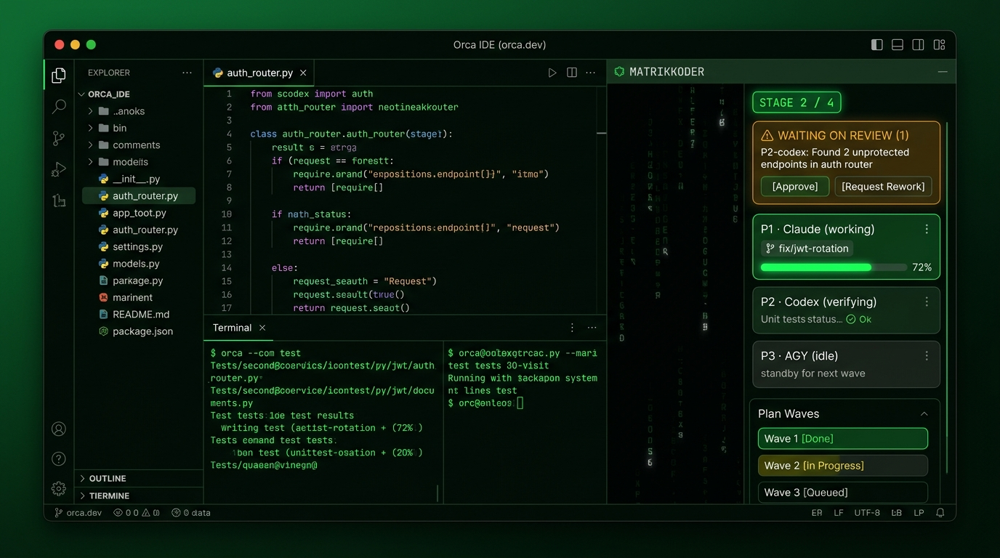

# Orca MatrixKoder

**MatrixKoder** is a visual multi-agent orchestration dashboard and lane supervisor plugin for the **Orca IDE** (`orca.dev`).

It connects your lead coordinator agent to parallel worker lanes across Git worktrees (Claude Code, Codex, AGY, OpenCode), rendering a real-time cyberpunk HUD sidebar with live wave progression, verification gates, and human approval inboxes.



---

## Features

- **Cyberpunk Matrix HUD Panel:** Sandboxed HTML/CSS/Canvas sidebar styled with Orca theme design tokens and an ambient digital rain animation.
- **Panel screens:**
  1. **Overview:** High-level stage progress, active wave meters, and fleet status summary.
  2. **Lanes:** Deep worker inspection with branch details, live diff links, and the 3-Gate Verification Matrix (Build / Test / Review).
  3. **Plan / DAG:** Wave-by-wave hierarchical task tracking with dependency gates.
  4. **Waiting on You:** Single-click approval inbox for blocking agent decisions and security checks.
  5. **Events:** Live streaming audit log of inter-agent bus messages and commits.
  6. **Inbox:** Staged plan importer with automatic template validation.
  7. **Bugs & Todo:** Integrated issue tracking with risk scoring and persistent session checklists.
  8. **Settings:** Orchestrator/Solo mode selection, safety tripwires, and animation controls.
- **Native Orca Engine Integration:** Directly leverages Orca's `orchestration.db` and live events (`agent.status.changed`, `worktree.created`).
- **Lean Architecture:** Completely offloads redundant file browsing and cron polling to Orca's built-in file tree and automations engine.

---

## Installation in Orca

### From GitHub (gets updates)

This repo is also an Orca plugin marketplace (`orca-marketplace.json`), so Orca can install the plugin and check it for updates.

1. Open **Orca Settings** (`Cmd+,`) › **Plugins**, open the marketplace **Sources**, and add `https://github.com/Interstellar-code/orca-matrixkoder.git` with ref `main`.
2. Install **MatrixKoder** from the list and accept its capabilities.
3. After a new release, click **Check for update** on the MatrixKoder card.

Each release moves the `ref` in `orca-marketplace.json` to the new tag.

### From a local build (development)

1. Open **Orca Settings** (`Cmd+,`).
2. Navigate to the **Plugins (EXPERIMENTAL)** tab.
3. Scroll to the **Development** section at the bottom.
4. Run `npm install && npm run build`, then enter the path to the staged `plugin/` folder
   (Orca refuses symlinks, so it cannot install the repo root):
   ```text
   <path-to-your-clone>/orca-matrixkoder/plugin
   ```
5. Click **Add path** and accept the requested capabilities (`workspace:read`, `terminal:send`, `notifications:show`, `events:subscribe`, `storage`).
6. The **MatrixKoder** icon (`layers`) will appear in your right sidebar activity bar!

---

## Development & Upstream Sync

This repository tracks two reference remotes (both have unrelated histories, so they are fetched, never merged):

1. `upstream`: MatrixKoder itself (`https://github.com/Interstellar-code/matrixkoder.git`), the orchestration logic this plugin follows.
2. `orca`: the official Orca IDE repository (`https://github.com/stablyai/orca.git`), for plugin API changes.

To set them up in a fresh clone:
```bash
git remote add upstream https://github.com/Interstellar-code/matrixkoder.git
git remote add orca https://github.com/stablyai/orca.git
```

To check both for updates:
```bash
npm run sync:orca
```

To build TypeScript worker changes:
```bash
npm run build
```

---

## Project Structure

```text
orca-matrixkoder/
├── orca-plugin.json         # Plugin manifest (ID, capabilities, panels, events)
├── package.json             # Build scripts & dev dependencies
├── tsconfig.json
├── src/
│   └── worker.ts            # Out-of-process Node.js background worker
├── out/
│   └── worker.js            # Compiled worker entrypoint
├── panel/
│   ├── screens/*.dc.html    # One file per panel screen, from the design canvas (mock data inside)
│   ├── runtime.js           # Renders the screens; no framework, CSP-safe
│   └── fonts/               # Geist + Geist Mono (OFL), inlined at build
├── web/
│   └── index.html           # Generated panel Orca loads (npm run build:panel)
├── skills/
│   └── matrixkoder/         # Bundled agent orchestration skill
├── scripts/
│   ├── build-panel.mjs      # Builds web/index.html from panel/
│   └── sync-orca-upstream.sh# Upstream Orca sync script
└── .matrixkoder/            # MK data folder, same layout as upstream ~/.matrixkoder
    └── inbox/               # Plan .md files waiting to be imported
        ├── research/        # Orca plugin API, CLI, bus and settings research
        └── assets/          # UI mockups and screenshots
```

---

## License

MIT © Interstellar-code
